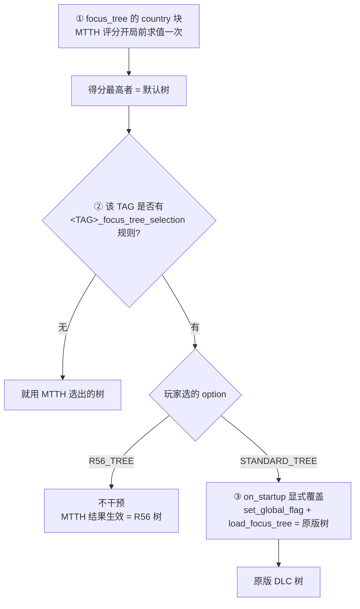

# 挂载点矩阵（R6 · 定稿）

> 目的：确定「互助会国别分支」到底要复制哪些文件——这是整个 C 需求成本与可维护性的唯一依据。
> 数据来源：R56 工坊 `2129897125` 的实际文件（`common/game_rules/00_game_rules.txt`、`common/on_actions/r56_focus_tree_selection_on_actions.txt`、`common/national_focus/*.txt`、`common/scripted_triggers/`）。
> 复核工具：`reference/tools/scan-multi-tree.ps1`、`reference/tools/scan-tree-rules2.ps1`、`reference/tools/scan-attach-sizes.ps1`

---

## 1. 结论摘要

**用户提出的问题成立，且比预想更严重：这些国家的「默认加载哪棵树」是按国家逐个设定的，而且不一致。**

- **11 个国家**存在「原版 DLC 树 / R56 树」二选一，玩家可在开局规则里切换 → 只改一棵树会让另一半玩家看不到互助会分支。
- **6 个国家**只有一棵树，无此问题。
- 成本从 `10-requirements-soviet-expansion.md` §5.2 估的 **17 文件 / ≈181,000 行**，上修为 **29 文件 / 275,682 行**（全部支持）或 **17 文件 / ≈197,000 行**（只支持默认树）。

---

## 2. 裁决机制（三层，按先后顺序）

**要点**

1. MTTH 只是**初选**。R56 用 `on_startup` 里的 `load_focus_tree` 做**二次覆盖**。
2. 覆盖由**游戏规则选项**触发。规则是 **R56 自己定义**的（不在原版里），位于 `common/game_rules/00_game_rules.txt`。
3. 规则名在本机**只有 R56 定义**、原版没有 —— 所以脱离 R56 单独跑这些树会失效。
4. **R56 共定义 23 个这类规则**：`AFG AUS BEL BUL CHI DEN EST GER GRE ICE INS IRQ LAT LIT NOR POR RAJ SIA SPR SOV SWE SWI TUR`。

---

## 3. 完整挂载点矩阵

「默认」列 = 玩家不动规则时实际加载的树。

| 国家 | 有规则 | 规则默认 | **默认加载树** | 默认树文件 | 可选树 | 可选树文件 | 文件数 |
| --- | --- | --- | --- | --- | --- | --- | --- |
| 🇨🇳 PRC | ❌ | — | `china_communist_focus_sea` （MTTH 1000） | `china_communist_sea.txt` | `china_communist_focus` | `china_communist.txt` | 2 |
| 🇸🇪 SWE | ✅ | **R56_TREE** | `swe_focus` | `r56_sweden.txt` | `sweden_focus` | `sweden.txt` | 2 |
| 🇳🇴 NOR | ✅ | **R56_TREE** | `r56_norwegian_focus` | `r56_norway.txt` | `norwegian_focus` | `norway.txt` | 2 |
| 🇦🇫 AFG | ✅ | **R56_TREE** | `r56_afghanistan_focus` | `r56_afghanistan.txt` | `afghanistan_tree` | `afghanistan.txt` | 2 |
| 🇩🇰 DEN | ✅ | **STANDARD_TREE** | `danish_focus` | `denmark.txt` | `denmark_focus` / `collab_denmark` / `free_denmark` | `r56_denmark.txt` | 2 |
| 🇮🇸 ICE | ✅ | **STANDARD_TREE** | `iceland_tree` | `iceland.txt` | `Iceland_focus` | `r56_iceland.txt` | 2 |
| 🇪🇹 ETH | ❌ | — | `ethiopia_tree`（MTTH 30） | `ethiopia.txt` | `eth_focus` | `r56_ethiopia.txt` | 2 |
| 🇭🇺 HUN | ❌ | — | `wuw_hungarian_focus`（MTTH 50） | `hungary_wuw.txt` | `hungarian_focus` | `hungary.txt` | 2 |
| 🇵🇭 PHI | ❌ | — | ⚠️ **平局**（10 : 10） | `philippines.txt` 或 `r56_philippines.txt` | 同上 | 同上 | 2 |
| 🇦🇷 ARG | ❌ | — | ⚠️ **平局**（10 : 10） | `argentina.txt` 或 `r56_argentina.txt` | 同上 | 同上 | 2 |
| 🇫🇷 FRA | ❌ | — | `french_focus` | `france.txt` | `free_french_focus` `vichy_french_focus` | `free_france.txt` `vichy_france.txt` | 3 |
| �🇺 SOV | ✅（死规则） | STANDARD_TREE | `soviet_focus`（MTTH 10） | `soviet.txt` | ~~`soviet_focus_old`~~ | ~~`soviet_old.txt`~~ | **1** |
| 🇲🇳 MON | ❌ | — | `Mongolia_focus` | `mongolia.txt` | — | — | 1 |
| 🇫🇮 FIN | ❌ | — | `finnish_focus` | `finland.txt` | — | — | 1 |
| 🇸🇦 SAU | ❌ | — | `saudi_focus` | `saudi_arabia.txt` | — | — | 1 |
| 🇨🇺 CUB | ❌ | — | `cuban_focus` | `Cuba.txt` | — | — | 1 |
| 🇵🇱 POL | ❌ | — | `polish_focus` | `poland.txt` | — | — | 1 |

### 三个需要注意的细节

1. **SOV 的规则是死规则。** `SOV_focus_tree_selection` 定义了（默认 `STANDARD_TREE`，另一选项 `OLD_TREE`），但在 `r56_focus_tree_selection_on_actions.txt` 里**引用数为 0** —— 没有任何代码去读它。所以 SOV 实际仍由 MTTH 决定，加载 `soviet.txt` 的 `soviet_focus`。**这是好消息**：我们的核心圈挂载点明确唯一。
2. **平局（PHI / ARG）** 是引擎未定义行为。MTTH 同为 10 分时不保证谁赢。稳妥做法是**两个文件都改**，别赌。
3. **FRA 有三棵树**，但 `free_france.txt` / `vichy_france.txt` 只在法国变成自由法国 / 维希时才生效。若不打算支持那两条假设线，只改 `france.txt` 即可（但要写进已知限制）。

---

## 4. 成本

| 方案 | 文件数 | 行数 | 说明 |
| --- | --- | --- | --- |
| **只支持默认树** | 17 | ≈ 197,000 | 玩家不动规则时功能完整；改规则则分支消失 |
| **全部支持（含可选树）** | **29** | **275,682** | 无论选哪个规则都能玩到，但维护面翻倍 |

各文件实测规模见 `reference/reports/attach-sizes-report.txt`。最大三个：`soviet.txt` 29,564 行、`hungary_wuw.txt` 20,119 行、`poland.txt` 19,892 行。

⚠️ 对比 `10-requirements-soviet-expansion.md` §5.2 的原估（17 文件 / ≈181,000 行）：**原估算偏低**，原因是①PRC 实际挂的是 `china_communist_sea.txt`（14,652 行）而非 `china_communist.txt`（7,591 行）；②匈牙利按 `hungary_wuw.txt`（20,119 行）计已含在内，但其余国家的可选树未计入。

---

## 5. 方案选项（已决策）

### 5.1 已定结论

| 事项 | 决定 | 依据 |
| --- | --- | --- |
| **目标覆盖范围** | **尽量两棵都覆盖**（玩家两棵树都可能玩） | 用户 2026-09-13 |
| **实施顺序** | **先按用户习惯**：大多数国家用原版树，**阿富汗例外用 R56 树** | 同上 |
| **法国** | **不支持**自由法国 / 维希两棵假设树，只改 `france.txt` | 同上 |
| **苏联老树** | **不考虑** `soviet_old.txt` | 同上 |

> 🔄 **2026-09-25 起本节标题里的「17 个」已过期** —— 挂载点已增到 **23** 个
> （S5 经互会 22 个 + **1 个「非经互会点」`hon_std`**）。
> ⭐ **唯一权威出处 = [`build/attach-points.json`](../build/attach-points.json)**（同步脚本每次现场读取）；
> 本轮新增的「非经互会挂载点」机制与洪都拉斯改造见 [`docs/100`](100-non-s5-mount-points-honduras.md)。

### 5.2 已落地的 phase 1（17 个挂载点 / 205,698 行 / 4.39 MB）

清单见 `build/attach-points.json`。要点：

- 大多数国家用**原版那棵**（SWE / NOR / DEN / ICE / PHI / ARG / ETH / FRA / PRC）
- 🇦🇫 **阿富汗是唯一例外**，用 R56 那棵（`r56_afghanistan.txt`）
- 单树国家直接取其唯一树（MON / FIN / SAU / CUB / POL / SOV / HUN）
- 🇭🇺 匈牙利：MTTH 50 分碾压 10 分，**R56 树是唯一可达者**，用户没有选择余地

### 5.3 phase 2 待补（8 棵可选树）

SWE / NOR / AFG / DEN / ICE / ETH 的另一棵，以及 PHI / ARG 的平局对手（`r56_philippines.txt`、`r56_argentina.txt`）。

---

## 6. 由此对同步脚本的要求

同步脚本（S1 产出）必须满足：

1. **挂载点由清单驱动**，而不是把 17/29 个路径硬编码进脚本。
2. 清单里每个挂载点记录：`目标文件` + `树 id` + `源（R56 / 原版）` + `锚点位置`。
3. 支持「同一个国家多个挂载点」——即一次导出多份副本。
4. 幂等：重复运行不产生重复注入。

---

## 7. 待办

- [ ] 决定方案 A / B / C
- [ ] PHI / ARG 的 MTTH 平局结果实测（S2 阶段开 `-debug` 后可直接看加载了哪棵树）
- [ ] FRA 是否支持自由法国 / 维希两棵假设树
- [ ] 把挂载点矩阵导出成同步脚本可读的清单文件
