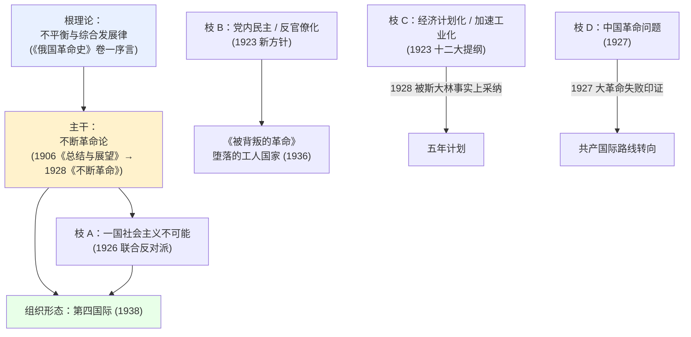

# 21 · 托洛茨基：理论谱系与贡献关系图（国策树的取材骨架）

> **为什么另立此文**：`docs/20` §1.1 给的是**平行分类清单** —— 按「理论/政治/军事/经济/国际」
> 分了五堆。那是**索引**，不是**结构**。
>
> 它的致命问题是回答不了设计国策树时真正要问的四件事：
> 1. 哪几条是**强相关**的，可以串成一条线？
> 2. 哪个理论是哪个理论的**基础**（谁推出谁）？
> 3. 哪条主张**后来被推翻/被他自己放弃**，不能算贡献？
> 4. 哪条**后来被事实证明正确、或成了什么的源头**（奠基性影响）？
>
> 本文只回答这四个问题。素材条目本身仍在 `docs/20` §1.1。

---

## 0. 来源

| 标记 | 来源 |
| --- | --- |
| `[辞]` | **《马克思主义思想辞典》**（博托莫尔等编，中文马克思主义文库）—— 条目级权威，用于**理论定位** |
| `[先]` | 多伊彻《武装的先知 1879–1921》`[解]`《被解除武装的先知 1921–1929》 |
| `[B]` | Britannica 人物条目 |
| `[中]` | 中文马克思主义文库其它（年谱、怀特《如何组织红军》） |
| `[待核实]` | 未抓到一手来源 |

> ⚠️ 本文所有「关系判断」都尽量给出出处。凡我自己推导的连接，一律标 `【推断】`。

---

## 1. 总谱系图



**读法**：根（R）推出主干（T）；主干分出 A、E 两支；B、C、D 是他**在同一场党内斗争中
同时提出的三条要求**（不都由 T 推出，但互相咬合）。

---

## 2. 理论谱系（谁推出谁）

### 2.1 根：不平衡与综合发展律

| 项 | 内容 |
| --- | --- |
| 出处 | **托洛茨基《俄国革命史》第 1 卷序言** —— 见 `[辞]`「不平衡发展」条目**参考书目②** |
| 上游 | 马克思；列宁《帝国主义是资本主义的最高阶段》(1916) 是同条目参考书目① |
| 内容 | 各国发展**速度**不平衡；落后者可以**越过**若干发展阶段、直接采用最先进的形式（"综合发展"） |

> 📌 **它是根**，因为它是唯一一个**能解释「为什么俄国这种落后国家反而能先革命」**的原理 ——
> 而这正是他全部政治主张的立足点。

### 2.2 主干：不断革命论

`[辞]`「托洛茨基主义」条目**原文**：

> 托洛茨基主义的**奠基石一直是不断革命论**，这种理论**最初是马克思提出来的**，
> **1906 年由托洛茨基针对俄国的情况重新加以表述，随后又在 1928 年进一步阐发**。

| 项 | 内容 |
| --- | --- |
| 载体 | 1906《总结与展望》（狱中写成）→ 1928《不断革命》 |
| **推导** | **由根推出**：不平衡 → 俄国落后 → 无产阶级先于资产阶级成熟 → 民主革命**由工人阶级领导** → 直接**转入**社会主义革命 → **一国不能完成** → 必须扩展到国际 `【推断，基于 `[辞]` 两条目并置】` |
| 状态 | 1924–25 被党内判为「门什维克异端」，在「托洛茨基主义 vs 列宁主义」论战中被压制；**但后来成为托派理论基石** |

> ⚠️ **注意**：`[辞]` 说它「最初是马克思提出来的」—— 所以它**不是纯原创**，
> 托洛茨基的贡献在于**把它俄国化、并推到国际结论**。

### 2.3 枝 A：一国社会主义不可能

- **由主干直接推出**：若革命不能在一国完成，"一国建成社会主义"就是空话。
- 1926 联合反对派，斥斯大林的一国社会主义论为「放弃世界革命的借口」`[B]`
- 对手：斯大林；1926 年时布哈林站在斯大林一边（斯大林—布哈林领导层）`[B]`

### 2.4 枝 B：党内民主 / 反官僚化（**这条最值得做线**）

| 项 | 内容 |
| --- | --- |
| 起点 | 1923 年 10 月致中央委员会的批评信（指控党内民主被破坏）→「新方针」争论 `[B]` |
| **理论内核** | `[辞]`「托洛茨基主义」条目：**他警告说，党要提防用自身代替无产阶级或是支配无产阶级** |
| 下游 | **《被背叛的革命》(1936)** → 「堕落的工人国家」 |
| **外部影响** | `[辞]`「极权主义」条目在列举苏联性质诸说时，明确提到「**官僚统治的制度（托洛茨基提出的）**」 |

> 📌 **这是「他的判断后来被历史承认」最硬的一条**：一个 1923 年的警告，
> 被 1930 年代的现实兑现，并被中立的学术辞典当作一个**成型的学说**收录。

### 2.5 枝 C：经济计划化 / 加速工业化

| 项 | 内容 |
| --- | --- |
| 关键文本 | **1923 年十二大的报告与提纲** |
| 评价 | `[解]` 原文：托洛茨基所作的报告和所提交的"提纲"**是苏联经济史上最关键的文件**；他在其中**描绘了今后几十年的苏联经济远景** |
| 1926 | 联合反对派要求加速工业化 |
| **奠基性影响** | **1928 年斯大林转向五年计划 = 事实上采纳了反对派的工业化主张** `【推断，但多伊彻的叙事支持】` |

> 📌 **这条是「被否决后又被对手拿去用」的典型** —— 做国策时戏剧性最强。

### 2.6 枝 D：中国革命问题（**与本 mod 的中苏线直接相关**）

| 项 | 内容 |
| --- | --- |
| 时间 | 1927 年春起 |
| `[解]` 原文 | 这次斗争是同到那时之前**从未提出过**的一个问题相联系的，但**从此以后这个问题却自始至终都是斗争的中心**，直到联合反对派最终被开除出党 |
| 主张 | 中共应**退出国民党**，采取**独立的工农革命政策** |
| 结果 | 屡次提议均被斯大林控制的第三国际拒绝 → **1927 大革命失败**，中共与工农群众在毫无戒备下遭屠杀 `[中]` |
| 著作 | 托洛茨基《中国革命问题》`[解]` 引用 |

### 2.7 组织形态：第四国际

- **由主干推出**：「一国不能完成革命」→ 需要一个**不受苏联官僚控制**的国际组织。
- 1938-09-03 正式成立 `[中]`
- `[辞]`「托洛茨基主义」参考书目⑤ 即《第四国际文件》

---

## 3. 有效性判定（**哪条不能算贡献**）

这是 `docs/20` 完全没回答的问题。判定分三档：

- ✅ **算贡献** —— 当时被否/被压制，但**后续被证明或成为源头**
- ⚠️ **算战术主张，非长期理论** —— 一次性判断，对错都不构成理论贡献
- ❌ **不能算贡献** —— 被否决**且他自己后来放弃或接受对方看法**

| # | 主张 | 当时结果 | 后续 | 判定 |
| --- | --- | --- | --- | --- |
| 1 | 不平衡与综合发展律 | 未被否 | 成为其全部理论的地基 | ✅ 根理论 |
| 2 | 不断革命论 | 1924–25 被判门什维克异端 | 成为托派奠基石 | ✅ |
| 3 | 一国社会主义不可能 | 1926 败于斯大林 | — | ✅ |
| 4 | 党内民主 / 新方针 | 1924 十三大被谴责为「门什维克式非法派别」 | 1936《被背叛的革命》延续；被学界收录 | ✅ |
| 5 | 经济计划化 / 加速工业化 | 1923 被压制 | **1928 斯大林五年计划采纳** | ✅ **奠基** |
| 6 | 中国革命问题 | 1927 被第三国际拒绝 | **大革命失败印证** | ✅ |
| 7 | 反法西斯统一战线 | 1930–33 被第三国际拒 | **纳粹上台；1935 共产国际七大转向人民阵线** | ✅ **奠基** |
| 8 | 反对向华沙进军 | 1920 被否，仍进军 | **华沙战役失败，事后证明他对** | ✅ |
| 9 | 第四国际 | 1938 成立 | 托派国际运动 | ✅ |
| 10 | **劳动军 / 经济军事化** | **1921 十大被否** | **他自己随后放弃** | ❌ **不能算贡献** |
| 11 | **工会国家化** | **1920–21 被否** | **1921 他自己接受列宁的常规看法** | ❌ **不能算贡献** |
| 12 | 布列斯特「不战不和」 | 1918 被否（列宁签约胜出） | 无 | ⚠️ 战术主张 |

> ⚠️ **第 10、11 条特别重要** —— 它们恰恰是最"上镜"的两条（劳动军、工会国家化听起来很有国策味），
> 但**托洛茨基本人后来都放弃了**。做国策时若把它们当"他的成就"，与他本人的立场相反。
> 若要写，应写成「**一次未遂的尝试**」，而不是「他的路线」。

---

## 4. 奠基性影响表（谁的源头）

| 他的什么 | 成了什么的源头 | 依据 |
| --- | --- | --- |
| 《俄国革命史》卷一序言的不平衡发展论 | 不平衡与综合发展理论（后世 M. 洛维《联合和不平衡发展的政策》） | `[辞]` 两处参考书目 |
| 1923 十二大经济提纲 | **「苏联经济史上最关键的文件」** → 五年计划的思想先导 | `[解]` 原文 |
| 反法西斯统一战线主张 | 1935 共产国际七大**人民阵线** | `[中]` 年谱 |
| 中国问题主张 | 共产国际对殖民地半殖民地革命路线的转向 | `[解]` + `[中]` |
| 《被背叛的革命》的官僚化分析 | 苏联研究中的「**官僚统治的制度**」说 | `[辞]`「极权主义」条目 |
| 「党可能代替无产阶级」的警告 | 先锋党蜕化批判传统 | `[辞]`「托洛茨基主义」条目 |
| 第四国际 | 托派国际运动 | `[辞]` 参考书目⑤ |
| **红军政委制度** | 苏联军事政治体制；后续各国共产党军队效法 | ⚠️ `[待核实]`（苏联部分 `[先]` 有据，**对其它国家的影响未核实**） |

---

## 5. 强相关聚类（**用于串国策链**）

这六簇是"天然成链"的，簇内成员**互为依据或互为同一斗争的不同侧面**。

### 簇 1 · 理论根干（纵向推导链，最直）

```text
不平衡与综合发展律 → 不断革命论 → 一国社会主义不可能 → 第四国际
```

### 簇 2 · 军事组织（他的实践核心，成员最密）

```text
从废墟建军 → 志愿军转征兵制 → 小而精的正规军 → 军事专家 + 政委
   ↘ 反游击主义（军事反对派） → 察里津与斯大林冲突
   ↘ 载体：《革命是怎样被武装起来的》
```

### 簇 3 · 经济曲折（「屡试屡败」链，冲突感最强）

```text
要市场(被否) → 劳动军(被否) → 工会国家化(被否) → 接受 NEP(退让)
   → 批评计划化不足(1923) → 要求加速工业化(1926) → 【1928 被斯大林采纳】
```

### 簇 4 · 党内民主（纵向链）

```text
1923 新方针 → 党内民主诉求 → 「党会代替无产阶级」的警告
   → 联合反对派(1926) → 《被背叛的革命》(1936)
```

> ✅ **本簇过了 `docs/23` §2.5 的「否定式主张三问判据」** ——
> 「反对官僚化」不是单纯否定式：
> ① 正面形式是「**党会代替无产阶级**」的警告；
> ② 提出了社会主义国家**自身**官僚化这个此前无人系统论述的问题；
> ③ 《被背叛的革命》系统化，**至今仍是批评苏联体制的核心内容**。
>
> 🔥 **这是全项目「反对 XX 可以独立成条」的唯一样板**（用户 2026-09-15 指定）——
> 其他人物写线时，拿这一条当尺子量。

### 簇 5 · 国际 / 殖民地（纵向链）

```text
创建第三国际(1919) → 中国革命问题(1927) → 反法西斯统一战线(1930-33) → 第四国际(1938)
```

### 簇 6 · 军事理论（思想层，与簇 2 平行）

```text
驳「军事科学的永恒真理」 → 反对拿破仑式进攻论
   ↘ 反对向华沙进军  ↘ 骑兵问题(先反对后接受)
```

> ⚠️ **本簇没有独立成支线** —— `docs/22` 把它并入了**支线 I「红军缔造」**。
> **理由**：① 它与簇 2 同属军事领域；② 按 `docs/23` §2.5「三问判据」，
> 其中「反对向华沙进军」只是**一次性战略判断**（事后证明对，但不成理论），
> 「骑兵问题」是**他自己改口**（❌ 档，同「劳动军」）；
> ③ 德国规格是每角色 **1–4** 条子线，已 5 条不能再加。
> 完整复核见 `docs/22` §3 的「2026-09-15 补记」。

---

## 6. 跨簇连接（**这些「钩子」是让树活起来的关键**）

| 连接 | 说明 |
| --- | --- |
| 簇 2 ↔ 簇 4 | 「军事专家+政委」与「党内纪律」是**同一逻辑**：党必须控制军事力量。察里津冲突**就是**党内斗争在军事上的第一次爆发 —— 一条军事线可以直接接进政治线 |
| 簇 5 ↔ 簇 4 | `[解]` 明说：**1927 中国革命问题是联合反对派斗争的「中心问题」** —— 国际线可以向上接进党内斗争线 |
| 簇 3 ↔ 簇 1 | 他既要**加速工业化**、又反对**一国社会主义** —— 这是一个尖锐的矛盾点，适合做成**互斥分支** |
| 簇 3 ↔ 簇 2 | 「劳动军」是**军事方法治经济**，是簇 2 的方法溢出到簇 3 —— 但他自己后来放弃了（见 §3 第 10 条） |
| 簇 1 ↔ 簇 5 | 不断革命论 → 必须输出革命 → 第三/第四国际。**理论直接生成组织** |

---

## 6.5 跨人物钩子（2026-09-15 追加）

> ⏸ **本节是草案，不是定稿** —— 跨人物钩子依赖**所有人的国策最终形态**，
> 用户 2026-09-15 定：**放全局最后做**（现在写 `prerequisite` 会死锁）。
> 详见 `docs/23` §1「跨人物钩子 = 全局最后一步」。
>
> ⚠️ **先看互斥约束，再看钩子** —— 与托洛茨基互斥的人**永远不可能同席**，
> 任何「要求某人已入席」的 `prerequisite` 都会**死锁**。权威出处 `docs/10` §2.4.2。
>
> 📌 **用户口径（2026-09-15）**：**只钩「现有且强相关」的人**，
> 不为凑机制去造弱关系或无关系。

### A. 互斥约束（托洛茨基）

| 对象 | 互斥？ | 依据 |
| --- | :-: | --- |
| 联合营（季诺维也夫、加米涅夫） | ❌ **互斥** | 1922–24 三人团排挤，1926 短暂结盟，**1927 彻底破裂** |
| 右营（布哈林、李可夫、托姆斯基、里亚京） | ❌ **互斥** | 1926 年布哈林站在斯大林一边打托洛茨基；经济轴理论完全对立 |
| 工反营（施利亚普尼科夫） | ❌ **互斥** | 1920–21 工会大辩论（劳动军事化 vs 工会独立） |
| 体制营（马林科夫、赫鲁晓夫、伏罗希洛夫） | ❌ **互斥** | R1 历史关系恶劣 |
| **左营同营 5 人** + **中立营 6 人** | ✅ 不互斥 | — |

→ **可同席共 11 人**：左营 5（普列奥布拉任斯基、拉狄克、斯米尔加、伊万·斯米尔诺夫、谢列布里亚科夫）
+ 中立营 6（加里宁、李维诺夫、索柯里尼柯夫、图哈切夫斯基、沃兹涅先斯基、彼得·斯米尔诺夫）。

### B. 跨营钩子（**这才是真正需要钩子的地方**）

| 人物 | 营 | 与托洛茨基的史实关系 | 强度 | 判定 |
| --- | :-: | --- | :-: | --- |
| **图哈切夫斯基** | `neutral` | **1918–21 一直在托洛茨基任军事人民委员期间升迁**：1919 年任第 5 集团军司令（东线反高尔察克）、1920 年任西方面军司令（苏波战争）、1921 年镇压喀琅施塔得。他与伏罗希洛夫的「骑兵派」对立，主张**机械化与正规军建设**，与托洛茨基建军路线一致 | ⭐⭐⭐ | ✅ **推荐**：「红军建设」支线可直接要求他入席 |
| 索柯里尼柯夫 | `neutral` | 1923–24 左翼反对派倾向 → 1925 转向 → 1926–27 加入联合反对派 → 1927 被开除 | ⭐⭐ | ⚠️ 可用但**偏弱**：他反复摇摆，不属托洛茨基核心圈 |
| 加里宁 | `neutral` | 全俄中央执行委员会主席；**1925–27 支持斯大林批托洛茨基** | ✗ | ❌ **不钩**（政治对立，只是未构成「直接敌对」才留在中立营） |
| 李维诺夫 | `neutral` | 外交领域，1920s 不卷入派系斗争 | ✗ | ❌ **不钩**（无任何史实关联） |
| 沃兹涅先斯基 | `neutral` | 1903 年生，1935 年才任列宁格勒市计委主席 | ✗ | ❌ **不钩**（与托洛茨基差 24 岁，时间线不重叠） |
| 彼得·斯米尔诺夫 | `neutral` | 1917 年后在波罗的海舰队；1937 年任海军人民委员 | ✗ | ❌ **不钩**（无具体关系记录） |

### C. 同营内部（左营 5 人）—— 关系真实，但**不构成「钩子」**

同营本来就能同席，不需要 prerequisite 打通。此处仅作素材登记：

| 人物 | 与托洛茨基的史实关系 | 强度 |
| --- | --- | :-: |
| **谢列布里亚科夫** | **1919–1920 任全俄中央执行委员会主席团秘书**；**1920-04-05 – 1921-03-08 任俄共（布）中央书记**（与克列斯廷斯基、普列奥布拉任斯基同任「三书记」，三人因支持托洛茨基因「НКПС 问题」去职）；**1922–1924 【副】交通人民委员**；**左翼反对派核心、《四十六人声明》签署者**；1937-01 第二次莫斯科审判四名主要被告之一，1937-02-01 枪决 | ⭐⭐⭐ |
| **普列奥布拉任斯基** | **左翼反对派首席经济理论家**；《新经济学》(1926) 的「社会主义原始积累规律」是左翼反对派经济纲领的理论核心 | ⭐⭐⭐ |
| **斯米尔加** | 1923 年《四十六人声明》签署者；1926–27 联合反对派成员 | ⭐⭐ |
| **伊万·斯米尔诺夫** | 1923 年《四十六人声明》签署者；**1936-08 第一次莫斯科审判与季诺维也夫、加米涅夫同案被处决** | ⭐⭐ |
| **拉狄克** | 1923 年左翼反对派 → **1924 年倒向多数派攻击托洛茨基** → 1926–27 联合反对派 → 1929 年公开投降斯大林 | ⭐⭐（关系复杂） |

> ⚠️ **两处不能用的「假钩子」**：
> 1. **普列奥布拉任斯基 ≠ 托洛茨基的合著者**。《共产主义ABC》(1919) 的合著者是
>    **布哈林 + 普列奥布拉任斯基**（两人 1924–25 经济辩论后成了死对头）。
>    而**布哈林属右营、与普列奥布拉任斯基互斥**（R2）→ 这条合著关系**用不了**。
> 2. **谢列布里亚科夫曾任「彼得格勒军事革命委员会秘书」（主席为托洛茨基）** ——
>    ✅ **2026-09-17 已核实：ru / en 两版维基均无此说**，而他 1917-02 在**科斯特罗马**、
>    1917 夏起在**莫斯科** → ⛔ **不予采用**（`docs/41` §2）。
>    📌 **同时订正了本表上方的两条事实**（原写「1919–20 党中央书记」与「1920–21 交通人民委员」）——
>    ⚠️ 后者**是托洛茨基自己的职务**。完整职务年表与依据见 [`docs/41`](41-serebryakov-genealogy.md) §4。

### D. 结论（与布哈林对照）

| | 跨营强钩子 | 跨营中等 | 如实列为「无关联」 |
| --- | --- | --- | --- |
| **托洛茨基** | **1 条**：图哈切夫斯基（军事） | 1 条：索柯里尼柯夫 | 4 人（加里宁、李维诺夫、沃兹涅先斯基、彼得·斯米尔诺夫） |
| **布哈林** | **1 条**：加米涅夫（1928-07-11 秘密会面） | — | 同上一批中立营人 |

**→ 托洛茨基不缺钩子**，且同营 5 人全部有真实史实关系（秘书／理论合作者／声明联署者）。
**跨营部分如实只有 1 条强钩子（图哈切夫斯基）**，其余按用户口径**不做**。

---

## 7. 与他人的对照（做对比分支时用）

| 人 | 立场 | 与托洛茨基的关系 |
| --- | --- | --- |
| **列宁** | 签约布列斯特 / 工会只管劳动条件 / 对托洛茨基评价「才能卓越但过于自信」 | 1917–23 合作；1922–23 列宁请他对付三人团 `[B]` |
| **斯大林** | 一国社会主义 / 1928 五年计划 | 主要对手；察里津冲突起家 `[B][中]` |
| **布哈林** | 1918 主张「革命战争」（第三条路线）；1925 主张**允许富农更富**，认为新经济政策目的就在利用私人企业重建俄国经济 `[解]` | 1926 站在斯大林一边打托洛茨基；**1928–29 被斯大林清算** |
| **季诺维也夫 / 加米涅夫** | 1922–23 与斯大林结三人团排挤托洛茨基；1926 又与他组联合反对派 | 先敌后友 `[B]` |
| **李可夫** | 右翼（与布哈林同） | 1929 后被清算 |

> 💡 **一条极好的国策素材**：`[解]` 第四章标题就是「生活不仅仅是政治……」——
> 他 1925 年被免军职后转任**电气技术发展局局长**，那段时间正是他理论产出最密集的时期。

---

## 8. 尚未核实

| 项 | 待核实内容 |
| --- | --- |
| 《文学与革命》 | 他的文化/文学理论贡献本轮**未找到一手来源**，`docs/20` 也没列。若要写文化线，须先补 |
| 红军政委制度对其它国家的影响 | §4 表最后一行 |
| 1928 斯大林采纳反对派工业化主张 | 属史家共识，但我只拿到多伊彻的叙事，**未找到明确的一手判定** |
| 工人集团 / 工人真理派 | `[解]` 提到党内基层民主团体，细节未展开 |
